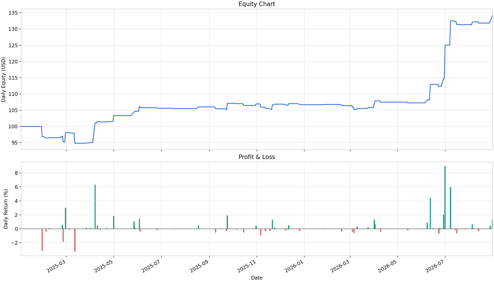

# Intraday Pairs Trading Research Backtester

A Python research backtester for intraday pairs trading using US equity
and ETF CFD data from MetaTrader 5.

The project combines liquidity screening, cointegration testing,
spread modelling, bar-by-bar trade simulation, and performance analysis.
It is designed for research and experimentation, not live trading.

## Research results

Selected historical experiment using M1 data from
2 January 2025 to 31 August 2026.



| Metric | Value |
|---|---:|
| Calendar trading sessions, including days without trades | 416 |
| Initial accounting balance | $100.00 |
| Final balance | $134.19 |
| Total return over the full period | +34.19% |
| Maximum bar-level equity drawdown | 7.87% |
| Annualized Sharpe ratio | 1.22 |

The Sharpe ratio uses a 4% annual risk-free rate.

Gains were unevenly distributed: a substantial part of the equity
increase occurred during June–July 2026, while other periods showed
limited progress or drawdowns.

This is an exploratory result, not an independent out-of-sample
evaluation. Execution and capital assumptions are described under
[Research limitations](#research-limitations).

### Configuration of the illustrated experiment

| Parameter | Value |
|---|---:|
| Timeframe | M1 |
| Opening confirmation window | 120 minutes |
| Liquidity assessment period | 10 sessions |
| Liquidity rolling window | 5 sessions |
| Historical cointegration requirement | 1 session |
| Minimum half-life | Greater than 2 minutes |
| Maximum holding time | 6 × estimated half-life |
| Entry z-score threshold | 1.5 |
| Mean-reversion exit threshold | 0.5 |
| Adverse z-score stop threshold | 6 |
| Base lot size for the first leg | 1 |
| Minimum coverage quantile | 0.90 |
| Minimum tick-volume quantile | 0.50 |
| Maximum spread quantile | 0.50 |
| Historical screening FDR level | 0.10 |
| Opening confirmation FDR level | 0.05 |
| Maximum absolute morning mean z-score | 0.75 |
| Maximum absolute last morning z-score | 2.5 |
| Session cutoff | 60 bars |

These settings reflect exploratory experiments and are not claimed
to be optimal or validated for live trading.

## Strategy workflow

1. **Liquidity screening**  
   Evaluate historical bar coverage, tick volume, and relative spread.
   Require instrument data across the selected historical sessions,
   calculate rolling quality statistics, and apply quantile thresholds.

2. **Historical pair selection**  
   Screen price series for integration order, run Engle–Granger
   cointegration tests, and apply Benjamini–Hochberg correction.
   Retain pairs meeting the historical-session requirement.

3. **Opening confirmation**  
   Repeat screening for candidate pairs using the opening portion
   of the current session.

4. **Spread modelling**  
   Estimate the historical regression intercept and hedge ratio,
   calculate spread statistics, and estimate mean-reversion half-life.
   Overnight transitions are excluded from half-life estimation.

5. **Morning stability filters**  
   Calculate morning z-scores using the historical spread model.
   Filter pairs by their mean and last morning z-score, and by half-life.

6. **Trade simulation**  
   Process each pair bar by bar. Enter on z-score deviations and exit
   on mean reversion, an adverse z-score threshold, a holding-time limit,
   or the session cutoff.

7. **Performance analysis**  
   Aggregate pair histories into portfolio realized and unrealized PnL,
   balance, equity, drawdown, and daily returns.

Tick volume is treated as a broker-feed activity proxy, not as
exchange-traded share volume.

## Implementation

- SQLite storage for market bars and instrument specifications.
- Exchange-calendar-based session handling.
- Configurable liquidity and cointegration screening.
- Linear-regression hedge-ratio estimation.
- Position sizing using contract sizes and broker lot constraints.
- Direction-aware bid–ask execution approximation.
- Separate simulation, performance-analysis, and visualization functions.
- Calendar-based inclusion of sessions without trades in performance analysis.

### Session cutoff

`cutoff_bars` specifies the bar, counted from the end of the available
session data, at which open positions are closed and new entries
are blocked.

- `1`: close on the final bar.
- `60`: close on the 60th bar from the end; this is the default.

The parameter counts bars, not minutes. With complete session data
and execution at bar close, `60` corresponds to 59 minutes before
session end on M1 and 295 minutes on M5.

If the cutoff covers the entire available trading window,
no positions are opened.

### Performance calculations

```text
Balance = initial capital + cumulative realized PnL
Equity  = balance + unrealized PnL
```

- **Total return:** change in balance relative to initial balance.
- **Maximum drawdown:** largest percentage decline in bar-level equity
  from its running peak.
- **Annualized Sharpe ratio:** mean daily excess return divided by
  the sample standard deviation of daily returns, multiplied by √252.

The risk-free-rate argument uses annual percentage points:
`4` means 4% per year.

The equity chart displays end-of-session values. Intraday drawdowns
can therefore be larger than those visible in the chart.

## Project structure

```text
src/
    config.py                     # Local paths and market settings
    data/                         # MT5 access, SQLite, trading calendars
    analysis/                     # Screening, spread models, metrics, plots
    strategies/
        intraday_strategy/
            backtest_tools.py     # Simulation and backtest orchestration
            general_tools.py      # Strategy preparation helpers
            research/
                run_backtest.py
                inspect_session.py
                analyse_results.py
            charts/
                backtest_performance_1.png

tests/
    analysis/
    data/
    strategy/
    mt5_tests/                    # Tests requiring an MT5 connection


requirements.txt
pytest.ini
```

Market databases and raw backtest histories are not included.
Research scripts, configuration values, and the selected summary chart
are public.

## Installation

Tested environment: **Windows, Python 3.14.0**.
Dependencies are pinned in `requirements.txt`.

Run from the project root:

```powershell
python -m venv .venv
.\.venv\Scripts\python.exe -m pip install -r requirements.txt
```

The MetaTrader5 Python package is currently required even for offline
tests because the shared timeframe module imports its constants.
A running terminal is needed for data collection and MT5 integration
tests, but not for backtesting an existing database.

## Tests

Run the default suite:

```powershell
.\.venv\Scripts\python.exe -m pytest
```

These tests use synthetic data and temporary SQLite databases.
They do not connect to a terminal or require the historical market
database.

Coverage includes database operations, trading calendars,
pair screening, spread calculations, trade simulation,
and performance metrics.

Run terminal-dependent tests separately:

```powershell
.\.venv\Scripts\python.exe -m pytest tests/mt5_tests
```

These require a configured terminal, accessible symbols,
and available historical data.

## Usage

### 1. Prepare market data

Configure `src/config.py`:

- SQLite database path.
- MetaTrader 5 terminal path.
- Exchange calendar.
- Broker-specific timezone settings.

The loader is broker-specific. Review symbol naming and timestamp
conversion before using a different feed.

After checking the download period and timeframe, run:

```powershell
.\.venv\Scripts\python.exe -m src.data.db_sync
```

This connects to MT5 and updates the local database.
Backtesting requires both market bars and instrument specifications,
including point size, contract size, and lot constraints.

### 2. Run a backtest

Set the period, timeframe, strategy parameters, and output filename in:

```text
src/strategies/intraday_strategy/research/run_backtest.py
```

Run:

```powershell
.\.venv\Scripts\python.exe -m src.strategies.intraday_strategy.research.run_backtest
```

The script saves bar-level simulation history to Parquet.

### 3. Analyse the result

In `analyse_results.py`, configure the input Parquet path,
matching date range and timeframe, initial balance,
and annual risk-free rate.

Run:

```powershell
.\.venv\Scripts\python.exe -m src.strategies.intraday_strategy.research.analyse_results
```

The script prints performance metrics and saves the equity
and daily-return chart.

Research scripts use manually configured paths. Relative paths
are resolved against the working directory, not automatically
against the script's location. Adjust the input path before
running from the project root.

## Research limitations

### Execution and costs

Signals and simulated execution use the same bar close.
This is an optimistic assumption, not a next-bar-open execution model.

Ask prices are approximated from bid close, recorded bar spread,
and instrument point size. Actual execution quotes may differ.
Commissions, slippage, financing, and market impact are not modelled.

Unrealized PnL is first revalued after the entry bar, so entry costs
are not immediately reflected in that bar's equity.

### Position sizing and capital

The backtester does not check whether available capital and margin
are sufficient to open all positions.

The $100 initial balance in the illustrated experiment is an accounting
baseline, not an estimate of the capital required to trade the strategy.
Percentage returns depend on the chosen balance and lot size.

### Data and statistical validity

Results depend on broker data, data quality, and modelling assumptions.
The session cutoff assumes that input data extends to the intended
session end. Current research focuses on M1.

Historical cointegration does not guarantee future mean reversion.
Repeated experimentation on the same historical period can introduce
selection bias and overfitting.

This project demonstrates a research workflow.
Its backtest results should not be interpreted as expected live returns.